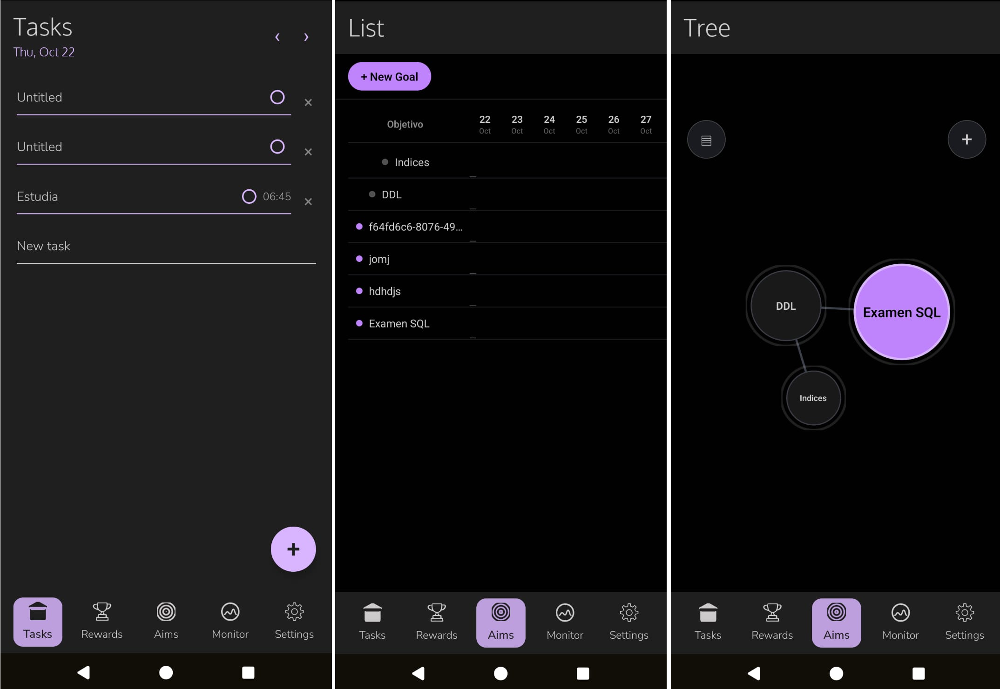

# NeuroPlanner

NeuroPlanner is a React Native application designed to help users plan and organize their tasks with flexible views and themes.

## Features

- Multiple view modes with toggle tabs for easy switching
- Clean and modern user interface based on a dark theme
- Component-based architecture for flexibility and scalability
- Supports authentication via access tokens

## Getting Started

1. Clone the repository
2. Install dependencies with `npm install` or `yarn install`
3. Run the app on your simulator or device with `npm run ios` / `npm run android`

## Project Structure

- `src/` — Main source code including components and views
- `docs/` — Documentation and design assets
- `assets/` — Icons and images used in the app

## Icon

---

Feel free to contribute or open issues for any bugs or feature requests!

